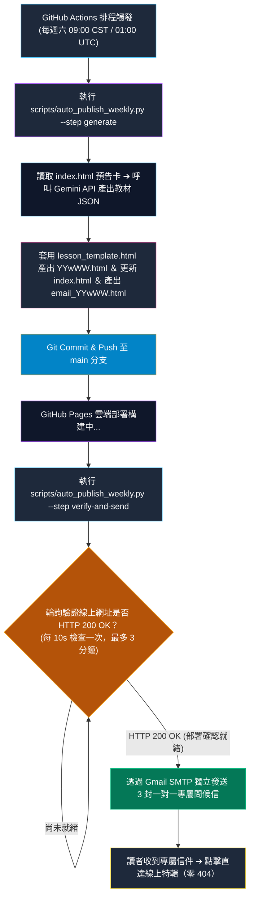

# Thai_Weekly (泰語學習週報自動化發布系統) 專案協作手冊

> **專案版本**：v2.0 (GitHub Actions 原地一條龍全自動發布版)  
> **最後更新日期**：2026-10-26  
> **維護者**：Martin × Antigravity (Anti) × Gemini API

---

## 1. 專案願景與協作架構 (Vision & Pipeline)

### 1.1 願景 (Vision)
打造一個**全自動、零手動維護、支援原地標準語音播放與卡片互動自測**的現代化泰語自主學習網站。每週六定時自動編纂精選時事與生活實務主題，享有沈浸式泰國皇室紫金雜誌閱讀體驗、雙引擎 TTS 語音發音與高效率學習工具。

### 1.2 v2.0 原地一條龍全自動流水線 (End-to-End Cloud Pipeline)

在 v2.0 架構中，系統**徹底廢除 Google Drive 中轉站與 Gemini 聊天室排程**，徹底根治以下三大痛點：
1. **Google Drive 根目錄權限卡死**（避免服務帳號或檔案存取因雲端硬碟權限受限）。
2. **真人確認卡攔截**（避免聊天室排程等待人工點擊確認卡而停滯中斷）。
3. **時序顛倒 404 漏洞**（強制加入 HTTP 200 OK 輪詢驗證機制，確保 GitHub Pages 部署完畢後才寄信）。



### 1.3 核心角色與分工
* **Martin (主理人)**：定義每週課程走向、審閱線上站點體驗與整體演進方向。
* **GitHub Actions (雲端全自動化心臟)**：
  * 每週六 09:00（台灣時間）定時喚醒，執行原地一條龍腳本。
  * 呼叫 Google Gemini API 自動完成高品質繁中內容生成。
  * 自動套版、更新門戶首頁、Git Push 與 GitHub Pages 部署。
  * 嚴格防呆把關：確認 HTTP 200 成功後，透過 Gmail SMTP 獨立寄發專屬電子報。

---

## 2. 目錄與檔案結構規範 (Repository Structure)

```text
Thai_Weekly/
├── .github/
│   └── workflows/
│       └── weekly_auto_publish.yml # 每週六 09:00 原地一條龍全自動出刊與寄信 Workflows
├── scripts/
│   └── auto_publish_weekly.py      # 一條龍核心腳本（Gemini API 產出、套版、防呆檢驗、Gmail SMTP 寄信）
├── templates/
│   └── lesson_template.html        # 紫金雜誌版標準 HTML 骨架（34px 單字、25px 句子、雙引擎 TTS）
├── favicon.svg                     # 專屬深邃曜石黑 × 科技藍漸層泰語學習 App 圖標
├── index.html                      # 站點首頁（方案 1 置頂封面 + 方案 4 即時搜尋手風琴抽屜）
├── 26w41.html                      # 第 1 期課程實體頁（飲食預訂實務・語法名詞化與九皇齋節）
├── 26w42.html                      # 第 2 期課程實體頁（交通指引・機場退稅與水燈節前哨）
├── 26w43.html                      # 第 3 期課程實體頁（飯店入住退房・房型設施與客訴溝通實務）
├── email_26w43.html                # 26w43 專屬皇室紫金 HTML 電子報模板
├── HANDBOOK.MD                     # 本專案協作手冊（規格與最高指引）
└── README.md                       # 專案概覽說明
```

* **每週獨立課程命名規則**：`YYwWW.html`
  * `YY`：公元年份後兩碼（例如 `2026` 年為 `26`）
  * `w`：固定小寫字母 `w`（表示 week）
  * `WW`：兩位數週次（01 ~ 53，例如第 43 週為 `43`，檔名即為 `26w43.html`）

---

## 3. 技術與 UI / UX 規範 (Design & Interaction System)

### 3.1 視覺風格：泰國皇室紫金風 (Dark Editorial Magazine UI)
全站統一採用高對比、護眼且極具大皇宮金箔質感的配色系統：

```css
:root {
  /* 背景層次 */
  --bg-base: #0d0814;          /* 暹羅暗夜紫底 */
  --bg-surface: #170f24;       /* 皇室深紫表層 */
  --bg-card: #231738;          /* 帝王紫卡片背景 */
  --bg-card-hover: #2f1f4a;    /* 卡片懸浮高光 */
  --border: #443063;           /* 沉穩紫金邊框 */
  --border-accent: #f59e0b;    /* 泰皇金箔高光邊框 */

  /* 皇家金色系統（佛寺金箔與尊爵榮耀） */
  --accent-gold: #f59e0b;       /* 泰皇金箔金（主要按鈕、標題裝飾） */
  --accent-gold-light: #fde68a; /* 亮香檳金（重點文字與標籤） */
  --text-thai: #fde047;         /* 泰文字級專屬金色（黑底金字極致辨識度） */
  --gold-glow: rgba(245, 158, 11, 0.28); /* 金色發光光暈 */

  /* 皇室紫色系統 */
  --primary: #a855f7;          /* 皇家紫羅蘭色（功能按鈕、標籤） */
  --primary-hover: #c084fc;    /* 亮紫高光 */
  --primary-glow: rgba(168, 85, 247, 0.3);

  /* 文字與中性色 */
  --text-main: #f8fafc;        /* 象牙白主文字 */
  --text-muted: #a78bfa;       /* 柔紫灰輔助次要文字 */
}
```

### 3.2 字級規格與版面佈局
* **容器寬度**：桌機主要容器 1160px，視窗 `>= 1400px` 自動延展至 1240px。
* **字級規格**：
  * **34px 核心泰語單字**：黑底金字高對比，音標清晰。
  * **25px 情境泰語句型**：加強跟讀與實務應用辨識。
  * **17.5px 正文閱讀**：行高 1.7 ~ 1.8，搭配柔和象牙白。

### 3.3 原地語音雙引擎播放系統 (Dual-Engine Audio & Referrer-Policy)
1. **安全性防護（必備）**：
   ```html
   <meta name="referrer" content="no-referrer">
   ```
   * 移除請求中的 `Referer` 標頭，防止 Google TTS 伺服器因來源阻擋回傳 404。
2. **雙引擎備援機制**：
   * **第一引擎 (Primary)**：Google 泰語標準 TTS 原地串流 (`audio/mpeg`)。
   * **第二引擎 (Fallback)**：若 Google TTS 受阻，無縫降級切換至瀏覽器原生 **Web Speech API** (`SpeechSynthesisUtterance`，指定 `th-TH`)。
3. **文化單字發音擴充 (`culture-vocab-sec`)**：
   * 每期文化專題文末必備 8 組文化專題精選語彙，各附獨立發音按鈕 🔊。

### 3.4 門戶首頁收納與檢索機制（方案 1 ＋ 方案 4）
* **Spotlight Hero**：最新刊置頂呼吸燈大封面，直覺進入最新課程。
* **近期特輯區 (`#recent-grid`)**：展示最新發布之期數，末張卡片自動更新為「下期即將推出 ⏳」預告。
* **歷史手風琴抽屜 (`#grid-2026`)**：過往期數依年份收納，**預設為折疊狀態**。
* **毫秒級即時搜尋**：輸入任意字詞即強制展開手風琴抽屜進行全域檢索；清除關鍵字後自動恢復折疊。

---

## 4. 自動化環境變數與 GitHub Secrets 設定

為了讓 GitHub Actions 能原地完成生成與寄信，必須在 GitHub 倉庫設定以下 Secrets：

| 變數名稱 | 說明 | 範例 / 來源 |
| :--- | :--- | :--- |
| `GEMINI_API_KEY` | Google AI Studio 產生的 Gemini API Key | 於 [Google AI Studio](https://aistudio.google.com/) 取得 |
| `GMAIL_USER` | 發信用的 Gmail 帳號 | `voyager.martin@gmail.com` |
| `GMAIL_APP_PASSWORD` | Google 帳戶 16 位元應用程式專用密碼 | 於 [Google 帳戶安全性](https://myaccount.google.com/apppasswords) 產生 |

### 4.1 收件人清單與個別問候規範
系統發送電子郵件時，採用**一對一獨立發送**，嚴禁將所有人合併列在 `To` 或 `Cc` 中：

1. `("Martin", "voyager.martin@gmail.com")` ➔ 問候語：`早安 Martin！`
2. `("Annie", "anniechen0209@gmail.com")` ➔ 問候語：`早安 Annie！`
3. `("昌哥", "tienzitw@yahoo.com.tw")` ➔ 問候語：`早安 昌哥！`

---

## 5. 里程碑記錄 (Milestones)

- [x] **v1.0**：全站深色雜誌風升級為「大皇宮金箔 × 暹羅暗夜紫」主題。
- [x] **v1.1**：完成 34px 大字級與 1160px/1240px 桌機沉浸式排版升級。
- [x] **v1.2**：解決 Google TTS 播放失敗問題，完成 `<meta name="referrer">` 防護與 Web Speech API 雙引擎備援。
- [x] **v1.3**：完成首頁「方案 1 ＋ 方案 4」檢索與折疊收納架構。
- [x] **v2.0 (重大升級)**：
  - [x] 發布 **26w43《飯店入住退房・房型設施與客訴溝通實務》**，更新首頁 Spotlight Hero。
  - [x] 擴充文化專題 8 組精選文化單字與原地發音功能 (`culture-vocab-sec`)。
  - [x] 徹底廢除 Google Drive 中轉站與 Gemini 聊天室排程，全面升級為 **GitHub Actions 原地一條龍全自動發布系統**。
  - [x] 建立 `scripts/auto_publish_weekly.py` 與 `.github/workflows/weekly_auto_publish.yml`。
  - [x] 實作 GitHub Pages 上線 HTTP 200 輪詢防呆機制與 Gmail SMTP 獨立一對一寄信。
